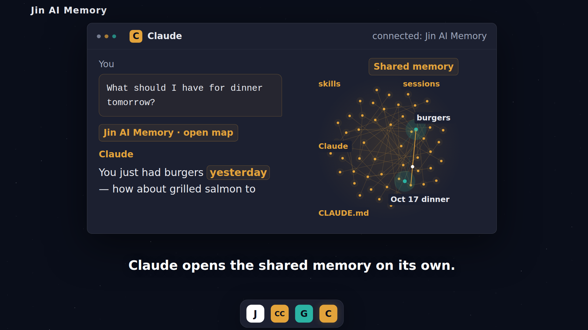
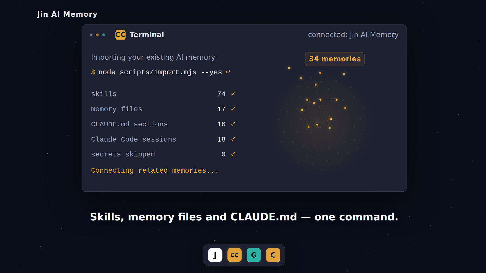
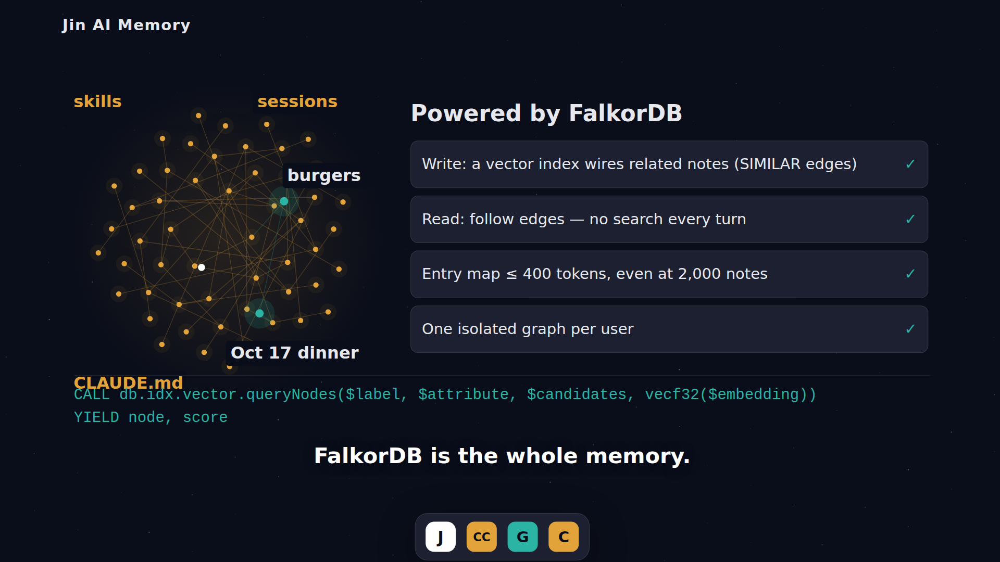

# Jin AI Memory

One memory for every AI you use. Bring what you already have, share it between ChatGPT and Claude, and see exactly what each AI used.

**Bring the memory you already have**: one command turns your Claude Code skills, memory files, CLAUDE.md sections and past sessions into linked notes.<br>
**Share it across AIs**: ChatGPT, Claude and other MCP clients read and write the same graph, stored in FalkorDB. [One command](#connect-your-ai) connects the AI tools on your machine to your own memory server.<br>
**See it**: a live 2D/3D map colors each note by the AI that wrote it and lights up the notes an AI just read or wrote.

**Want to use it with your own AIs?** Please **star this repository**. It tells us people want it, and starring is the easiest way to follow the public sign-up.



*Demo-video still with fictional data, not a client screenshot.*

## Demo

**Demo video:** [Watch on YouTube](https://youtu.be/1_GeZ6HTHMY) (about 1 minute)

**Live preview, no token:** [Open the sample graph](https://yukeidaro.github.io/jinai-memory/?mock=1)
or [open it in 2D](https://yukeidaro.github.io/jinai-memory/?mock=1&view=2d) (GitHub Pages, loads instantly).
The Render deployment serves the same preview at
[jinai-memory.onrender.com/?mock=1](https://jinai-memory.onrender.com/?mock=1); its free service sleeps, so the first load can take about **50 seconds**.
The preview uses built-in samples and simulated access events, not live database reads.

**What you'll see**

- Import existing AI context into linked Markdown memories.
- ChatGPT saves a dinner preference and dated meal; Claude can open them the next day.
- Explore notes by writing AI, switch 2D/3D, and watch memory-access highlights.

In a manual check on October 17-18, 2026, ChatGPT's developer-mode connector saved
a preference and dated event without an explicit save request. The next day,
Claude's custom connector opened the map and referred to yesterday's meal without
being asked to read memory. Tool use and recommendations still depend on the model;
highlights show server-side access, not proof that a note influenced its answer.

## Try it in 1 minute

1. Open the **live preview** above and click a node. No account or token is needed.
2. For a working local MCP server, use **Node.js 24, Git and PowerShell**. No dependency installation or build is needed:

```powershell
git clone https://github.com/yukeidaro/jinai-memory.git
Set-Location .\jinai-memory
$env:MEMORY_TOKEN = [guid]::NewGuid().ToString("N") + [guid]::NewGuid().ToString("N")
$env:MEMORY_USERS = $null
$env:FALKORDB_URL = $null
$env:EMBEDDINGS_PROVIDER = "fake"
$env:EMBED_DIM = "128"
$env:MEMORY_USER = "demo"
$env:PORT = "8787"
$server = Start-Process node -ArgumentList ".\src\server.js" -NoNewWindow -PassThru
```

Wait for `Listening on port 8787`, then run in the **same shell**:

```powershell
node .\scripts\seed-demo.mjs http://localhost:8787 $env:MEMORY_TOKEN
Start-Process "http://localhost:8787/?token=$([uri]::EscapeDataString($env:MEMORY_TOKEN))"
```

This seeds **10 fictional memories** across four AI sources. It uses in-memory
storage, so restarting loses them; reseeding appends another ten.
Stop your local server with `Stop-Process -Id $server.Id`.
For persistence, set `FALKORDB_URL` privately before starting instead of clearing it.

## Bring your existing AI memory

Run the [combined importer](scripts/import.mjs) on your own machine:

```powershell
node .\scripts\import.mjs
```

The default is a **dry run**: no network requests or state writes. Example
inventory from the author's PC, not a benchmark or expected count:

```text
Dry run: nothing sent. Review with --verbose; to send, rerun with --yes.
skills                74 ✓
memory files          17 ✓
CLAUDE.md sections    16 ✓
Claude Code sessions  18 ✓
secrets skipped        0 ✓
```

Counts include unchanged eligible entries; a check mark does **not** mean an upload.
Use `--verbose` to review titles, paths and status, never note bodies or summaries.

| Extracted locally | Not imported |
| --- | --- |
| Claude Code and Copilot `SKILL.md` files; Claude Code project memory; global `CLAUDE.md` split at `##` headings | The `MEMORY.md` index |
| One dated event per eligible Claude Code session: first three human requests (up to 200 characters each), edited filenames, skills/agents, PR links and activity counts | Full transcripts, AI answer bodies (except extracted PR URLs), thinking, tool results, images and attachments |
| Project/file/skill tags that connect sessions | Scratch workspaces; detected secret-bearing file sections or session items |

After reviewing confidentiality, send only to **your own trusted server**. For the
local server started above:

```powershell
$env:JINAI_MEMORY_URL = "http://localhost:8787"
$env:JINAI_MEMORY_TOKEN = $env:MEMORY_TOKEN
node .\scripts\import.mjs --yes
```

The import token comes **only from `JINAI_MEMORY_TOKEN`**, never a CLI argument.
For hosted imports, use HTTPS and supply the token privately. `--home` selects
another home; `--root`, `--exclude-project`, `--since` and `--limit` filter sessions.
Use `--help` for options, or the separate [file](scripts/import-local.mjs) and
[session](scripts/import-transcripts.mjs) commands for independent control.

Successful sends update local state under `<home>\.jinai-memory`; unchanged entries
are skipped on reruns. Changed file sections append notes; changed sessions use
`externalId` to replace a note and `follows` to link consecutive sessions in a project.
Keep separate state for different servers/tokens. **Never commit personal files,
transcripts, extracted notes, tokens or import state to this repository.**
Secret detection is heuristic, not a confidentiality guarantee.



## How FalkorDB is the core

With `FALKORDB_URL` configured, **FalkorDB is the persistent memory store, vector
index and traversal engine**, including the UI snapshot, not a visualization sidecar.
Memory nodes hold Markdown, kind, dates and an embedding. `ABOUT` links Topics,
`MENTIONED_BY` records the writing AI, `RELATES_TO` holds explicit references, and
`NEXT_STEP` links a predecessor to the current imported session.

**Wire on write, follow on read.** Each `remember` embeds once, queries FalkorDB's
cosine vector index, and adds up to three `SIMILAR` edges with similarity >= 0.3.
Weights combine similarity and recency. `orient` supplies an entry map in the
`open` tool description; `open` follows edges without another embedding.
`recall` is a fallback that embeds the question once.

These query shapes come from the [FalkorDB adapter](src/store/falkordb-store.js):

```cypher
CREATE VECTOR INDEX FOR (n:Memory) ON (n.embedding)
OPTIONS {dimension: $dim, similarityFunction: $similarity}
```

```cypher
CALL db.idx.vector.queryNodes($label, $attribute, $candidates, vecf32($embedding))
YIELD node, score
WHERE any(label IN labels(node) WHERE label IN $labels)
RETURN node, score ORDER BY score ASC LIMIT $k
```

```cypher
MATCH (a {id: $id})-[r]-(n)
WHERE type(r) IN $types
RETURN DISTINCT n, r, startNode(r).id, endNode(r).id
ORDER BY coalesce(r.w, 0) DESC, n.id LIMIT $limit
```

Here `$similarity = "cosine"`, `$label = "Memory"`, `$attribute = "embedding"`,
and `$labels = ["Memory"]`. The vector procedure returns distance; the adapter
converts it to similarity. Topic opens use `$types = ["ABOUT"]`; Memory opens
omit the type filter. Reads traverse both directions.

The entry map stays within **400 estimated tokens**, including at **2,000 notes**
in the [in-memory scale test](test/scale.test.js). `open` returns at most five
neighbors within 800 estimated tokens. These are output bounds using a character
estimator, **not model-token measurements or constant database cost**.

Manual measurements on **2026-10-17**, from Japan with Render Ohio and FalkorDB
Cloud GCP us-central1: `remember` **0.5-0.9 s**, `recall` **0.35 s**, `orient`
**0.6 s**. These observations are not a throughput benchmark.



*Demo-video still with fictional data; token bounds above use the test estimator.*

## Connect your AI

**One command connects every AI tool on your machine:**

```powershell
$env:JINAI_MEMORY_TOKEN = "<token>"   # or leave it unset and type it at the hidden prompt
npx github:yukeidaro/jinai-memory init --server https://<host>
```

> **Bring your own server and token.** The hosted instance at `jinai-memory.onrender.com`
> is invite-only: it serves the demo and the author's own memory, and unknown tokens get
> `404`. To try the full flow, [deploy your own](docs/DEPLOY.md) (Render Blueprint plus a
> free FalkorDB Cloud instance), pick your own token in `MEMORY_USERS`, and pass your host
> with `--server` or `JINAI_MEMORY_URL`; there is no default server.
> `init` checks the token against the server before writing anything or copying a URL.
> A failed check stops without changing files or the clipboard.
> Without a server, the [live preview](https://yukeidaro.github.io/jinai-memory/?mock=1) shows the UI on sample data.

It detects Claude Code, Cursor, VS Code, Copilot CLI, Codex and Gemini CLI and adds the
memory server to each one's MCP config (with a backup beside each changed file).
For claude.ai and ChatGPT it shows where to paste the connector URL; `--copy claude`
puts that URL on your clipboard without printing it. Tokens are never taken as arguments
or printed, but the written config files contain the token-bearing URL, so keep them private.
`npx github:yukeidaro/jinai-memory remove` undoes only what `init` added.
Use HTTPS for hosted servers. HTTP is allowed only for `localhost`, `127.0.0.1`
or `[::1]`, for example `init --server http://localhost:8787`.
The check makes one MCP `tools/list` request and times out after 90 seconds.
Add `--dry-run` to preview without writing, copying, or contacting the server;
it reports `Token not verified (dry run).`

To connect a client by hand:

Cloud connectors need a reachable HTTPS deployment, not your PC's `localhost`.
Use your own host and replace `<encoded-token>` with **only the URL-encoded token**:

| Client | Setup | MCP URL shape |
| --- | --- | --- |
| Claude | Settings > Connectors > Add custom connector | `https://<host>/mcp/<encoded-token>-claude` |
| ChatGPT | Settings > Apps > Advanced > Developer mode > Create | `https://<host>/mcp/<encoded-token>-chatgpt` |
| Cursor / Copilot / other HTTP MCP clients | Add a remote HTTP MCP server | `https://<host>/mcp/<encoded-token>-cursor` (or `-copilot`) |

Menus and access depend on client version, plan and workspace settings.
Choose **No authentication** if asked: the URL carries a shared secret, not OAuth.
Keep token-bearing URLs private, including encoded ones. The source suffix is
an author label, not a permission boundary. MCP uses JSON-RPC over **HTTP POST**;
opening its URL in a browser returns 405. UI SSE at `/events` is separate.

`MEMORY_USERS` maps user names to distinct tokens and selects separate
`memory:<user>` graphs for MCP, snapshots and events. It overrides `MEMORY_TOKEN`
and `MEMORY_USER`; without it, the single-user default is `demo`.
See the [deployment guide](docs/DEPLOY.md) for configuration and URL encoding.

## MCP tools

| Tool | Input | Result / behavior |
| --- | --- | --- |
| `remember` | `kind`, `title`, Markdown `text`, one-line `summary`, `tags`; events require ISO datetime `occurredAt`. Optional `relatesTo`, `externalId`, `follows`. | `{ id, replaced }`, plus `followsLinked` when requested. Saves a preference, event, fact or decision; links context. |
| `open` | `id` or exact `title` of a Memory or Topic | `{ note, neighbors }`, including dates and `days_ago`; no embedding. |
| `recall` | `query` | `{ preferences, recent_events, others, hint }`; vector search plus Topic expansion. |
| `orient` | None | Refreshed entry-map string; no embedding. |

The server supplies `user` and `source`; they are not tool arguments. Clients may
cache the map from `tools/list`; call `orient` to refresh. Some map labels are Japanese.

## Architecture

See the [architecture diagrams and query counts](docs/ARCHITECTURE.md),
[HTTP API](docs/API.md) and [store contract](docs/CONTRACT.md).
The backend uses Node.js built-ins, including a RESP2 client for `GRAPH.QUERY`.

## Tests

Run `node --test`. The no-database run reports **323 tests: 322 pass, 1 skipped**.
Coverage includes imports, cross-client dinner recall, user isolation, secret
rejection, session replacement/linking, HTTP/SSE and response budgets.
The real-FalkorDB suite is opt-in with `FALKORDB_URL`; use a disposable test
database. Real-FalkorDB contract checks previously passed on FalkorDB Cloud
(2026-10-17); they were not rerun for this documentation update.

## Deploy

The [Render Blueprint](render.yaml) uses the Node 24 [Dockerfile](Dockerfile),
Ohio, the free plan and `/healthz`. Configure `FALKORDB_URL` privately for
persistence. Follow the [deployment guide](docs/DEPLOY.md) (Japanese); its warning
about missing `public/` is historical, since `public/index.html` is now included.

## Limitations & security

- **Demo data only on this Cloud setup.** The free FalkorDB Cloud endpoint uses unencrypted `redis://`; web HTTPS does not encrypt the database hop. `rediss://` requires a TLS-enabled endpoint.
- **Shared secrets, not accounts or OAuth.** Token holders can read/write their graph under any AI suffix. URLs can leak through history, logs or recordings; rotate leaked tokens and update clients.
- **Heuristic secret rejection.** MCP saves reject detected API keys, private keys, passwords and card numbers. This is not comprehensive detection; review confidentiality before importing.
- **Fake embeddings by default without an API key.** Hashed word/character features are not semantic understanding. For semantic embeddings, set `EMBEDDINGS_PROVIDER=openai` and `OPENAI_API_KEY`, remove the 128-dimension override (OpenAI defaults to 1536), and use a fresh user graph. OpenAI receives embedded content and fallback queries; the server does not auto-load `.env`.
- **Bounded output, not bounded scans.** Map/neighborhood work grows with the graph; `recall` has no token cap. `open` may shorten text; the UI shows the newest 500 Memory nodes with up to 8,000 characters each.
- **Prototype boundaries.** No delete/edit tool, per-agent permissions or automatic session sync. The browser needs WebGL and third-party rendering modules from jsDelivr. The server is not loopback-only; restrict inbound access on a trusted local network.

- **No public sign-up yet.** The hosted server is invite-only, so the GitHub Pages [live preview](https://yukeidaro.github.io/jinai-memory/?mock=1) shows the UI on sample data and the full flow needs [your own server](docs/DEPLOY.md). The CLI runs from GitHub (`npx github:yukeidaro/jinai-memory`) and is not on the npm registry. `init` was run by hand on Windows; macOS and Linux config paths are covered by automated tests only.
- **Next.** Per-user token issuance and a rate-limited, isolated sandbox graph so anyone can try the full flow without deploying a server. If you want this, please star the repository.

## Built during Graph Hacks

Built for **Graph Hacks: Context for AI Agents** (WeMakeDevs x FalkorDB),
**October 15-18, 2026**. This repository's memory service, importers and visualizer
were newly written during the hackathon; the [commit history](https://github.com/yukeidaro/jinai-memory/commits/main/)
records implementation on October 17-18. Primary track: **Agent Memory and
Coordination**; secondary track: **Company Brain**.

## License

[GNU AGPL-3.0-only](LICENSE).
