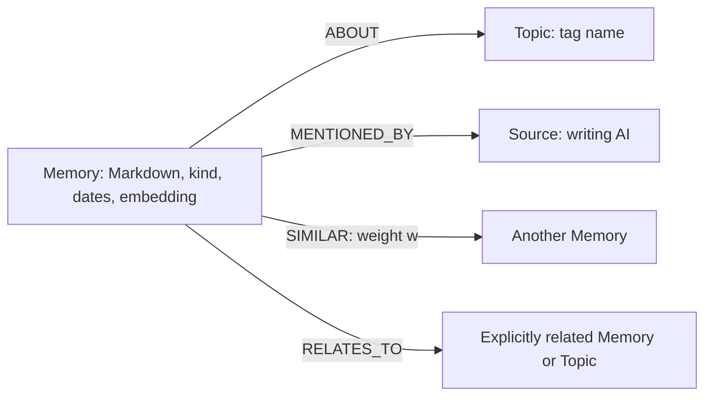
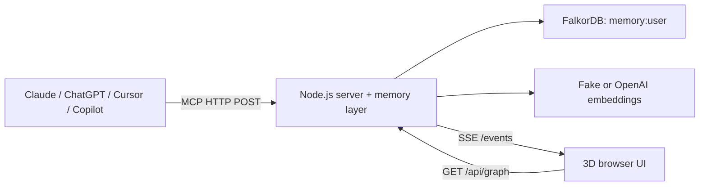

# Jin AI Memory

One memory graph for every AI you use — and you can see what it uses.

Built for **Graph Hacks: Context for AI Agents** (WeMakeDevs x FalkorDB).
Primary track: **Agent Memory and Coordination**.

**Demo video:** <!-- TODO: video link -->
**Public demo:** <!-- TODO: public demo URL, without a token -->

## The problem / What it does

Your AI tools do not share their memories. Tell ChatGPT something today, and
Claude needs the same introduction tomorrow.

Jin AI Memory exposes one user's graph over MCP to Claude, ChatGPT, Cursor, and
Copilot. It stores Markdown notes as **preferences, dated events, facts, or
decisions**. A 3D browser view colors notes by their writing AI, shows their
connections, and highlights nodes reported by memory operations. This is a
record of server-side memory access, not proof that a model used a note in its answer.

**Dinner example:** tell ChatGPT, "I like hamburger steak. Help me make a recipe,"
then save the meal as a dated event. The next day, ask Claude, "What should I have
for dinner?" It can open the shared dinner topic and see yesterday's meal.
Fallback `recall` separates preferences from `recent_events`, with `days_ago`.
The AI decides whether to avoid repeating dinner; the server does not exclude it.
The seed script supplies fictional Japanese notes for this story.

## How FalkorDB is the core

FalkorDB is the persistent store, vector index, and relationship traversal engine,
not an auxiliary visualization database. With `FALKORDB_URL` configured, all
memory operations and the UI snapshot use the FalkorDB adapter.



Relationships preserve authorship, connect synonymous tags to shared notes, and
make nearby context navigable without embedding a new question on every read.
`SIMILAR` edges are written in one direction; reads traverse either direction.
`RELATES_TO` comes from explicit references. `NEXT_STEP` is supported by the
store and visualization, but is not created by the current `remember` tool.

**Indexes.** `ensureIndexes` creates a cosine vector index on `Memory.embedding`
with the configured dimension, plus range indexes on `Memory.id`, `Topic.id`,
and `Source.id`. It waits for `OPERATIONAL` status and rejects an incompatible
existing vector index.

These are three actual query shapes from
[`src/store/falkordb-store.js`](src/store/falkordb-store.js):

**1. Create the vector index** (`$similarity` is `"cosine"`):

```cypher
CREATE VECTOR INDEX FOR (n:Memory) ON (n.embedding)
OPTIONS {dimension: $dim, similarityFunction: $similarity}
```

The ID index statement is `CREATE INDEX FOR (n:Memory) ON (n.id)`, also issued
for `Topic` and `Source`.

**2. Find vector neighbors**, including the label filter used by the memory layer:

```cypher
CALL db.idx.vector.queryNodes($label, $attribute, $candidates, vecf32($embedding))
YIELD node, score
WHERE any(label IN labels(node) WHERE label IN $labels)
RETURN node, score ORDER BY score ASC LIMIT $k
```

Here `$label = "Memory"`, `$attribute = "embedding"`, and `$labels = ["Memory"]`.
The procedure's `score` is cosine **distance**, so the adapter converts it to
similarity with `clamp(1 - distance, -1, 1)`. Before this filtered query it counts
embedded Memory nodes and sets `$candidates` to at least that count; it does not
request only `$k` candidates from the index.

**3. Traverse neighbors in both directions**, using the optional type filter:

```cypher
MATCH (a {id: $id})-[r]-(n)
WHERE type(r) IN $types
RETURN DISTINCT n, r, startNode(r).id, endNode(r).id
ORDER BY coalesce(r.w, 0) DESC, n.id LIMIT $limit
```

Topic reads set `$types = ["ABOUT"]`; ordinary Memory reads omit the `WHERE`
clause. The returned edge retains its original direction.

**User separation.** Every store method selects the graph `memory:<user>`.
Graph names are validated; values enter Cypher through parameters. Dynamic
schema identifiers are quoted, not treated as value parameters. The HTTP demo
uses one configured `MEMORY_USER` (default `demo`) for all AI sources: this is
graph-level namespacing, not a multi-account authentication service.

The dependency-free client uses `GRAPH.QUERY ... --compact` over RESP2, with
`node:net` for `redis://` and `node:tls` for `rediss://`.

## Why it stays cheap

**Wire on write, follow on read.** `remember` embeds the new note once, searches
for existing notes, and creates up to **3** `SIMILAR` edges above or equal to
**0.3** similarity. Their weight is:

```text
recency = exp(-age_in_days / 30)
w = 0.7 * similarity + 0.3 * recency
```

`tools/list` builds an `orient` entry map directly into the `open` tool
description. The AI can read that map and call `open` by title or ID instead of
searching every turn. `orient` and `open` make **zero embedding calls**; `recall`
is a fallback that embeds the question once.

| Response | Bound in the implementation |
| --- | --- |
| `orient` map | At most 5 topic groups; at most 400 estimated tokens |
| `open` | One note/topic plus at most 5 distinct neighboring nodes, which may include Topics and Sources; serialized result at most 800 estimated tokens |
| Scale check | 2,000 saved notes, 2,000 write embeddings; map and Memory/Topic opens retain those bounds with no extra embeddings |

The estimator charges **1 token per non-ASCII character and 1/4 per ASCII
character**; it is not a model tokenizer. Long `open` fields are shortened
without changing the stored note. These bounds cover the map and result payload,
not all MCP descriptions, wrappers, or a model's actual token count.

This bounds model-facing context, **not database work or latency**. `orient`
reads all Topics and their neighborhoods; `open` fetches a full neighborhood
before selecting five. The filtered vector search can request every embedded
Memory as a candidate. `recall` output has no corresponding token cap.

## Architecture



See [Architecture](docs/ARCHITECTURE.md) for query counts, data flow, SSE, and
the file map; [HTTP API](docs/API.md) and [store contract](docs/CONTRACT.md) for
payloads and adapter semantics.

## Quick start

Use **Node.js 24**, Git, and PowerShell. **No `npm install` or server build step
is needed**: the backend has no package dependencies. The browser needs WebGL
and network access to jsDelivr for its rendering modules.

### 1. Start locally, without external services

Clone this repository and enter its directory. In one PowerShell session:

```powershell
git clone https://github.com/yukeidaro/jinai-memory.git
Set-Location .\jinai-memory

$env:MEMORY_TOKEN = [guid]::NewGuid().ToString("N") + [guid]::NewGuid().ToString("N")
$env:FALKORDB_URL = ""
$env:OPENAI_API_KEY = ""
$env:EMBEDDINGS_PROVIDER = "fake"
$env:EMBED_DIM = "128"
$env:MEMORY_USER = "demo"
$env:PORT = "8787"

$server = Start-Process node -ArgumentList ".\src\server.js" -NoNewWindow -PassThru
```

This starts `node .\src\server.js` in the background so the same shell can seed
it without copying the token. Wait for `Listening on port 8787`, then run:

```powershell
(Invoke-WebRequest http://localhost:8787/healthz).StatusCode
node .\scripts\seed-demo.mjs http://localhost:8787 $env:MEMORY_TOKEN

$encodedToken = [uri]::EscapeDataString($env:MEMORY_TOKEN)
Start-Process "http://localhost:8787/?token=$encodedToken"
```

Expect HTTP **200** and
`Seeded 10 demo memories (chatgpt=2, claude=4, cursor=2, copilot=2).`
Click a node to read its Markdown; use **Group by AI** or the author filters.
Seeding again appends another ten notes.

For a visual-only preview, open `http://localhost:8787/?mock=1`. It uses built-in
samples and simulated events, without graph API or SSE calls; the browser still
loads rendering modules from the CDN.

Stop only the server you started when finished:

```powershell
Stop-Process -Id $server.Id
```

This first path uses **in-memory storage**: restart loses the notes. A healthy
`/healthz` checks the HTTP server, not continuing DB connectivity.

### 2. Use persistent FalkorDB storage

On a machine with Docker, start a local FalkorDB instance:

```powershell
docker run -p 6379:6379 falkordb/falkordb:latest
```

Keep Docker running in its terminal. In the application shell, stop the previous
application process, set the following, and repeat the server start and seed:

```powershell
$env:FALKORDB_URL = "redis://localhost:6379"
```

Check the startup log says `store: falkordb`. Notes now live in `memory:demo`,
outside the application process. The command above does not configure a Docker
volume; do not treat it as a durable backup.

### 3. Optional semantic embeddings

The local path and Render Blueprint explicitly use `fake`: deterministic hashed
word/character features, **not semantic understanding**. To use OpenAI, set
`EMBEDDINGS_PROVIDER=openai` and supply your `OPENAI_API_KEY` privately. Remove
the `EMBED_DIM=128` override or change it to **1536** for the default
`text-embedding-3-small` model. Use a new `MEMORY_USER` when switching providers
or dimensions; existing embeddings are not migrated.

The server does not automatically load `.env`. For file-based configuration use
the placeholders in [`.env.example`](.env.example) and
`node --env-file=.env .\src\server.js`, keeping real values out of Git.

## Connect your AI

For cloud-hosted connectors, first deploy to a reachable HTTPS host; they cannot
reach your PC's `localhost`. Replace `<host>` with your actual deployment host
and `<encoded-token>` with the **URL-encoded token only**:

| Client | Setup | MCP server URL shape |
| --- | --- | --- |
| Claude | Settings → Connectors → Add custom connector | `https://<host>/mcp/<encoded-token>-claude` |
| ChatGPT | Settings → Apps → Advanced → Developer mode → Create | `https://<host>/mcp/<encoded-token>-chatgpt` |
| Cursor | Add an HTTP MCP server in the client's MCP configuration | `https://<host>/mcp/<encoded-token>-cursor` |
| Copilot | Add an HTTP MCP server in a client supporting remote MCP | `https://<host>/mcp/<encoded-token>-copilot` |

Available menus and custom-connector access depend on client version, plan, and
workspace settings. Choose **No authentication** if asked: the URL carries the
shared secret; this server does not implement OAuth. All four suffixes use the
same user's graph. The suffix identifies the writing/calling AI, not a separate
permission boundary, and can be chosen by any token holder.

Encode `+`, `/`, and `=` in generated tokens as `%2B`, `%2F`, and `%3D` (for
example, with `[uri]::EscapeDataString`). Keep the stored environment value
unencoded. The UI URL shape is `https://<host>/?token=<encoded-token>`.
Never publish any token-bearing URL, including encoded ones.

MCP accepts JSON-RPC over **HTTP POST**, returning JSON; this is not a stdio or
legacy SSE MCP endpoint. Opening an authenticated MCP URL in a browser returns
**405**. `/events` is a separate UI notification stream. The MCP server handles
`initialize`, `ping`, `tools/list`, and `tools/call`.

For the dinner demo, enable the connector in both clients, save the preference
and meal from ChatGPT, then ask Claude to open the dinner topic before answering.
The map is rebuilt on each `tools/list`; call `orient` explicitly if the client
caches an older tool description. Responses depend on the model and its tool use.

## Import your own Claude Code memory

Run the dependency-free importer locally with Node.js 24. **Never add personal
files, import state, tokens, or imported content to this repository.** The
checked-in `test/fixtures/import-home` contains fictional examples only.

First preview the metadata-only list in PowerShell:

```powershell
node .\scripts\import-local.mjs
```

The default is a **dry run**: no network requests and no state writes. It lists
status, kind, title, home-relative file path, and character count, never note
bodies or summaries. Review the titles and paths before enabling import.

The importer finds Claude Code skills (`~/.claude/skills/*/SKILL.md`), project
memory (`~/.claude/projects/*/memory/*.md`, excluding the `MEMORY.md` index),
global instructions (`~/.claude/CLAUDE.md`), and Copilot skills
(`~/.copilot/skills/*/SKILL.md`). Skills become facts; feedback becomes a
preference, project memory a decision, and other memory a fact. Only the final
segment of an encoded project folder is used as its project tag, not its full
path. Instructions split at `##` headings into preferences; a nonempty preamble
is preserved as its own entry, and a file without headings stays one entry.
Markdown code fences do not create sections. Text over 20,000 Unicode
characters is shortened to that limit, including a final `(truncated)` marker.

Set the base URL of **your own trusted server** and its token privately, then
rerun with explicit consent:

```powershell
$env:JINAI_MEMORY_URL = "http://localhost:8787"
# If you started this local server using the Quick start instructions:
$env:JINAI_MEMORY_TOKEN = $env:MEMORY_TOKEN
node .\scripts\import-local.mjs --yes
```

For a hosted server, supply `JINAI_MEMORY_TOKEN` through your private environment
or secret manager and use HTTPS. There is deliberately **no `--token` option**:
the token is read only from `JINAI_MEMORY_TOKEN`, never from command arguments.
`--server` overrides `JINAI_MEMORY_URL`; `--source` sets the MCP author suffix
(default `claude-code`, 1-20 lowercase letters, digits, or hyphens).

Use `--home <directory>` to scan a different home, `--only
skills,memory,claude-md,copilot` to select categories, and repeat `--include
<file.md>` to add Markdown files, independently of `--only`. Included files
use the same instruction-section conversion. For example:

```powershell
node .\scripts\import-local.mjs --home .\test\fixtures\import-home --only skills,copilot
```

The secret guard runs locally **before sending**, including on frontmatter and
untruncated text. Matches are marked `secret-skip` with only the rule type;
secret-looking titles/paths are redacted. Detection is heuristic, not a
guarantee: review your files and do not import confidential data. Redirects are
not followed, and neither tokens nor server error bodies are printed. Writes
are sequential; failures are reported safely and other entries continue.

Only successful imports update `<home>/.jinai-memory/import-state.json`.
`--state <file>` chooses another location; keep it outside the repository.
Unchanged file/heading hashes are skipped on later runs. Changed entries append
**new memories**, not updates: MCP has no update tool. Repeated headings are
tracked separately. Keep separate state files for different homes, servers, or
tokens; state is local bookkeeping, not a server backup. Removing state or
restarting an in-memory server does not reconcile earlier imports.

Imported memories go only to the graph authorized by your token on the selected
server. This demo maps its configured token to one `MEMORY_USER` graph; anyone
sharing that token can access the same graph. The importer does not upload
anything to this repository or other AI tools. The server's configured embedding
provider still applies (OpenAI embeddings send note data to OpenAI; `fake` does
not).

## MCP tools

| Tool | Input | Result / behavior |
| --- | --- | --- |
| `remember` | Required: `kind`, `title`, Markdown `text`, one-line `summary`, `tags`. Events also require ISO datetime `occurredAt`. Optional: `relatesTo` IDs/titles. | `{ id }`; embeds once, adds Topic/Source and related edges. Tool guidance asks for 3-5 synonymous/related tags; validation permits at most 10 tags and 20,000 text characters. |
| `open` | `id` or exact `title` of a Memory or Topic | `{ note, neighbors }`; note includes dates and `days_ago`; at most 5 neighbor summaries. No embedding call. |
| `recall` | `query` | `{ preferences, recent_events, others, hint }`; one query embedding, vector hits expanded through Topics. Events with `days_ago <= 7` are grouped as recent, not suppressed. |
| `orient` | None | Current entry map as a string, also embedded in the `open` description during `tools/list`. No embedding call. |

The server supplies `user` and `source` from its configuration and the URL;
these are not tool arguments. Some map labels and recall guidance are currently
Japanese, including relative-day labels.

## Tests

```powershell
node --test
```

Without `FALKORDB_URL`, **119 pass and 1 real-FalkorDB integration test is
skipped** (120 reported tests). Coverage includes cross-client dinner recall,
per-user isolation, vector/index query generation, SSE, and the 2,000-note
response-budget check. Real-database integration is opt-in via `FALKORDB_URL`;
use a disposable test database, never production credentials. It creates random
integration graphs and attempts to delete them afterward.

## Deploy

[`render.yaml`](render.yaml) deploys the Node 24 Docker image on Render's free
plan in **Ohio**, using `/healthz`. It generates `MEMORY_TOKEN`, fixes
`EMBEDDINGS_PROVIDER=fake` and `MEMORY_USER=demo`, and requests a FalkorDB URL
and an optional OpenAI key. Set a real FalkorDB URL privately or storage will
remain in-process.

Follow [the Render deployment guide](docs/DEPLOY.md) for Blueprint setup,
configuration, URL encoding, and cold-start troubleshooting. The guide is in
Japanese; its earlier warning that `public/` is missing is historical:
`public/index.html` is included in this checkout.

## Limitations & security

- **Demo data only.** The demo's FalkorDB Cloud free-tier connection uses
  unencrypted `redis://`. HTTPS to the web server does not encrypt the
  server-to-database hop. The client also supports `rediss://` when the database
  endpoint provides TLS.
- **Shared URL secret, not OAuth.** Token holders can read and append memory
  across AI sources. URLs can leak through history, logs, screenshots, or
  recordings. Rotate `MEMORY_TOKEN`, restart/redeploy, and update every client
  after a leak. Do not store personal, confidential, or real-user data here.
- **Local does not imply loopback-only.** The server listens without an explicit
  host; the Docker example publishes port 6379 without authentication options.
  Keep this demo on a trusted machine/network and restrict inbound ports.
- **Free hosting sleeps.** Render's free service can sleep after inactivity.
  Warm it before a demo; initial client requests may time out. In-memory notes
  do not survive process restarts.
- **No full memory lifecycle UI.** The four MCP tools do not provide deletion,
  editing, per-agent permissions, or automatic import of conversation histories.
  The AI must explicitly save notes and choose when to read them.
- **Bounded answers, not bounded scans.** `open` can truncate Markdown; the UI
  snapshot includes only the newest 500 Memory nodes and up to 8,000 characters
  per note, plus all Topics and Sources. `recall`, neighborhood scans, and map
  construction can grow with the graph. The 2,000-note test is an in-memory
  response-size check, not a cloud throughput benchmark.
- **External dependencies at runtime.** The browser imports third-party code
  from jsDelivr. OpenAI embeddings send note/title/tag text and fallback queries
  to OpenAI. Explicit `fake` needs no API key but does not supply semantic recall.

## License

[GNU AGPL-3.0-only](LICENSE).
