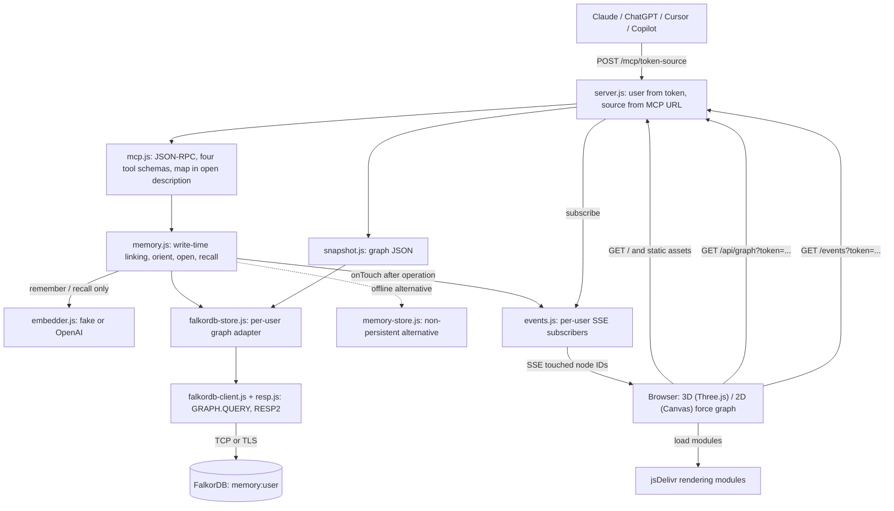
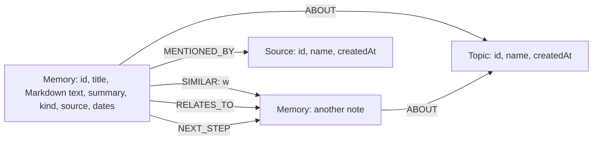
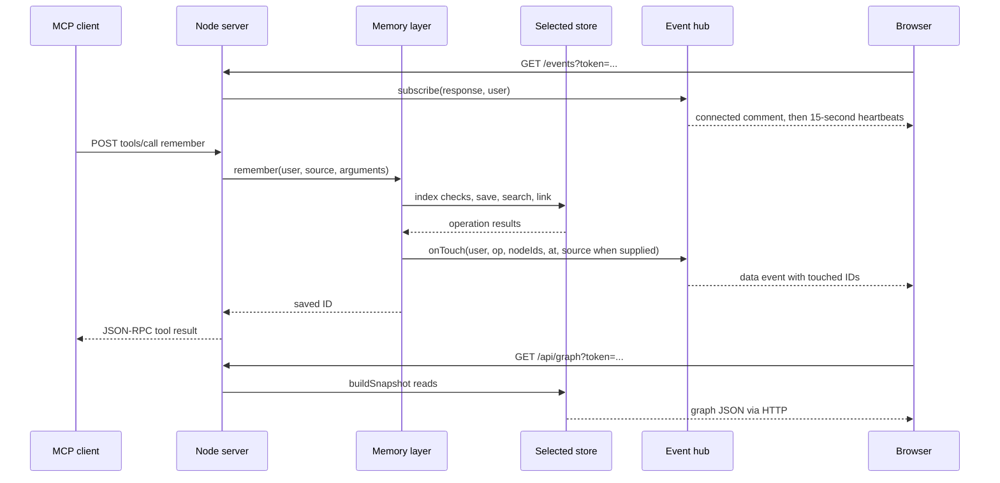

# Architecture

Jin AI Memory is one Node.js service exposing shared memory over MCP and a
read-only 2D/3D graph view. FalkorDB stores the persistent graph; without a configured
`FALKORDB_URL`, the same memory layer uses an in-process development adapter.
There are no backend package dependencies or build steps.

## Components



`MEMORY_USERS` maps user names to distinct tokens and overrides `MEMORY_TOKEN`
and `MEMORY_USER`. Without it, the service uses one configured `MEMORY_USER`
(default `demo`) and `MEMORY_TOKEN`. MCP, snapshots and SSE authenticate into
the same per-user graph. The MCP URL suffix identifies a source, not a tenant:
Claude and ChatGPT with the same token share `memory:<user>`. There is no account
system, OAuth, or separate per-source authorization.

## Data model and indexes



Only Memory nodes receive embeddings. The adapter removes embeddings from
returned node properties. Tags are represented as Topic nodes and `ABOUT`
edges, not a `tags` property on the saved Memory. The snapshot reconstructs the
tags from those edges.

`ensureIndexes({ user, dim })` checks:

| Label | Property | Index |
| --- | --- | --- |
| `Memory` | `embedding` | Vector; cosine; configured dimension |
| `Memory`, `Topic`, `Source` | `id` on each label | Range |

It checks existing vector dimension/similarity, creates missing indexes, and
polls `db.indexes()` until all are `OPERATIONAL` (10-second readiness deadline,
25 ms between unsuccessful polls). HTTP startup calls it for each configured
user before listening, and every `remember` calls it again.

All graph names are validated. Cypher values use the client's `CYPHER` parameter
prefix; dynamic label/relationship/property identifiers are backtick-quoted.
`GRAPH.QUERY <graph> <cypher> --compact` returns entities decoded by the custom
RESP2 client. Commands are serialized on one connection, with 10-second
connection/command timeouts. `redis://` selects TCP; `rediss://` selects TLS.

## Data flow and database query counts

Counts below are **adapter calls to `client.query`**, not guaranteed total
network round trips. They exclude startup, Redis `AUTH`/`SELECT`, and the
client's lazy schema lookups (`db.labels()`, `db.relationshipTypes()`,
`db.propertyKeys()`) when decoding unfamiliar entity metadata. Each schema
lookup adds a `GRAPH.QUERY`; the cache is cleared on reconnect.

`getNode`, `findNodes`, `listNodes`, `upsertNode`, `addEdge`, `removeEdges`, and `neighbors`
each issue one query. A `vectorSearch` invoked by the memory layer issues two:

1. `MATCH (n:Memory) WHERE n.embedding IS NOT NULL RETURN count(n)`.
2. `db.idx.vector.queryNodes` with label filtering and top-k ordering.

The procedure yields cosine distance. The adapter orders it ascending, then
returns similarity `clamp(1 - distance, -1, 1)`. For label-filtered calls it asks
for `max(k, embedded_memory_count)` candidates so post-filtering cannot hide a
valid match. Both current callers pass `labels: ["Memory"]`.

### remember

Writes are serialized per user within a memory-layer instance. One successful
call follows this sequence:

| Step | Work | Queries |
| --- | --- | --- |
| Resolve `relatesTo` | `getNode` on each reference, then resolve by ID or exact Memory title / Topic name | 2 per ID or Memory-title match; 3 per Topic-title match |
| Embed once | Embed title, text, and deduplicated tags together | 0 DB; 1 embedding call |
| Ensure indexes | Read `db.indexes()`, create missing indexes, poll readiness | `I = 1 + C + P`, where `C` is missing indexes (0-4) and `P >= 1` readiness reads |
| Resolve external ID | Look up the deterministic Memory ID when `externalId` is supplied | `e`, 0 or 1 |
| Save Memory | `MERGE` by ID, merge props, set Memory label and `vecf32` embedding | 1 |
| Replace outgoing links | On replacement, remove outgoing `ABOUT`, `MENTIONED_BY`, `SIMILAR` and `RELATES_TO` | `x`, 0 or 1 |
| Find similar notes | Filtered vector search with `k = 6`, including the newly saved note | 2 |
| Link similar notes | Exclude self, take up to 5 existing hits, require similarity at least 0.3, keep up to 3 | `s`, where `0 <= s <= 3` |
| Add Topics | One name lookup, optional node upsert, and `ABOUT` edge per unique tag | `2t + nT` |
| Add Source | One name lookup, optional node upsert, `MENTIONED_BY` edge | `2 + nS` |
| Add explicit links | `RELATES_TO` edge for each resolved unique reference | `r` |
| Link predecessor | If `follows` is supplied, look up its external Memory ID and add predecessor-to-current `NEXT_STEP` when found | `f + l`, each 0 or 1 |
| Notify | `onTouch` with new note and linked nodes | 0 |

Here `t` is unique tags, `nT` newly created Topics, `nS` is 1 for a new Source
and 0 otherwise, `r` is unique explicit references, and `D` is their total
resolution query count. Total:

```text
remember queries = D + I + 5 + s + 2t + nT + nS + r + e + x + f + l
```

An already-operational schema normally makes `I = 2`; a new graph needs four
index creations plus however many readiness polls are necessary. Startup has
already initialized the selected graph before HTTP requests can arrive.

Each `SIMILAR` edge uses
`w = 0.7 * similarity + 0.3 * exp(-age_in_days / 30)`. Age uses `occurredAt`
when present, otherwise `createdAt`, clamped to zero for future dates.
Topic edges have `w = 1`; Source and explicit edges have no assigned weight.
`externalId` replaces content at a deterministic ID within the user's graph;
replacement preserves incoming edges and existing `NEXT_STEP` edges. `follows`
references a predecessor's external ID in that same graph. The result is
`{ id, replaced }`, plus `followsLinked` when `follows` was supplied.

### open

| Lookup path | Queries |
| --- | --- |
| Memory or Topic ID | 1 `getNode` + 1 `neighbors` = **2** |
| Exact Memory title | 1 `findNodes` + 1 `neighbors` = **2** |
| Exact Topic name | Failed Memory-title lookup + Topic-name lookup + `neighbors` = **3** |

There is no embedding or vector query. The adapter query matches edges in both
directions, sorted by weight descending (missing weight is zero). Memory opens
can return neighboring Memories, Topics, and Sources. Topic opens restrict to
`ABOUT`, keep Memories, and order them by event/creation date, kind importance,
then weight.

The database limit is `Number.MAX_SAFE_INTEGER`: the memory layer deduplicates
the returned neighborhood and selects at most **5** nodes in JavaScript.
It then truncates result fields to **800 estimated tokens** (including the
serialized note metadata and neighbors). The full saved note is unchanged.
This is an output bound, not a bounded-neighborhood query.

### recall

One question embedding is followed by:

| Step | Queries |
| --- | --- |
| Filtered vector search, `k = 10` | 2 |
| List all Topics and find names contained in the normalized question | 1 |
| Read `ABOUT` neighbors for each vector hit | `V`, at most 10 |
| Read `ABOUT` neighbors for each distinct collected Topic | `U` |

**Total: `3 + V + U` queries**, no index setup during this operation. Candidates
combine vector matches and Topic-expanded Memories, ranked by similarity and
date. Results separate `preferences`, `recent_events`, and `others`.
`days_ago = floor(max(0, elapsed_days))`; events with `days_ago <= 7` are recent.
They are not excluded from recommendations. A recent-event hint asks the AI
to check before suggesting something already done.

The internal method accepts a result `limit`, but the MCP schema exposes only
`query`, so the public fallback has no result-count or token cap.

### orient and tools/list

`orient` lists all Memories for a count (**1** query), lists all Topics (**1**),
then reads `ABOUT` neighbors for each non-excluded Topic (**T** queries).
Import classification/hash-like Topic names are excluded before neighborhood
reads. If no remaining Topic has a connected Memory, it also lists the newest
Memory (**1** query) for touch notification.

**Total: `2 + T` queries, or `3 + T` for that empty/untagged case.**
There is no embedding call and no LLM-generated summary.

Topics are ranked using recent events, preferences/facts, and recency. When
specific topics exist, broad topics (at least 8 Memories and more than 25% of
all Memories) are omitted. Topics with exactly the same connected Memory set
share one map row. The output has
at most **5 groups** with up to **3 kind-specific snippets** each and a
**400-estimated-token** ceiling.

Every MCP `tools/list` calls `orient` and places the map in the `open` tool
description, adding exactly the same DB work. Tool discovery does not mean a
new map is fetched before every model turn: clients may cache descriptions.
The server advertises `listChanged: false`; an explicit `orient` can refresh
the map when needed.

## Response budgets versus scaling

The estimator in `memory.js` charges 0.25 token for an ASCII character and 1
for a non-ASCII character. These are not measured model-token counts.
[`test/scale.test.js`](../test/scale.test.js) writes 2,000 notes using the
in-memory adapter and verifies:

- Exactly 2,000 write embeddings; `orient` and `open` add none.
- Map at most 400 estimated tokens; Memory and Topic opens at most 800.
- At most 5 neighbors, including oversized-body/title/source cases.

The test establishes bounded model-facing payloads, not constant server cost.
Map construction, full neighborhood reads, all-candidate filtered vector
search, and uncapped fallback recall can grow with the graph.

## SSE and the browser snapshot



SSE is **UI notification**, not the MCP transport. It sends touched IDs and
operation metadata, not the updated graph. The UI fetches a snapshot on load,
after new-memory/missing-node events, and on its regular 30-second refresh.
It animates touches and colors notes by writing source.

The hub filters subscribers by user, caps them at **50**, and removes closed,
errored, or backpressured readers. It is process-local, with no replay log or
cross-instance broadcast.

`buildSnapshot` makes **3 list queries** (newest 500 Memories, all Topics, all
Sources), then **1 neighbors query per included node**: `3 + N` queries.
It deduplicates edges, includes only edges with both endpoints in the snapshot,
and truncates each Memory body to **8,000 Unicode characters**. Snapshot reads
do not invoke the memory layer or publish touch events.

`?mock=1` uses `public/mock.js` instead of the graph API and SSE; simulated
events fire every 3 seconds. Rendering modules still come from jsDelivr.
Clicking a displayed node reads its already-fetched snapshot, not an MCP `open`.
The visualizer records memory operations, not model reasoning or guaranteed
use of retrieved context.

## File map

| File | Role |
| --- | --- |
| `src/server.js` | Startup, health check, static files, token checks, MCP HTTP routes, snapshot and SSE endpoints |
| `src/config.js` | Select storage and embedding provider independently; validate embedding dimension |
| `src/mcp.js` | JSON-RPC initialization and dispatch, four tool schemas, contextual `open` description |
| `src/memory.js` | Notes, Topics/Sources, write-time links, query expansion, entry map, response budgets, touch callbacks |
| `src/embedder.js` | Deterministic feature-hashed fake vectors or OpenAI embeddings via `fetch` |
| `src/store/falkordb-store.js` | Store contract implemented with per-user FalkorDB graphs, indexes, and parameterized Cypher |
| `src/falkordb-client.js` | TCP/TLS connection, authentication, queued GRAPH.QUERY commands, compact decoding and schema cache |
| `src/resp.js` | Incremental RESP2 parser and command encoding |
| `src/store/memory-store.js` | In-process, non-persistent adapter for tests and offline development |
| `src/snapshot.js` | Read-only HTTP graph projection, tags reconstructed from edges, node/body limits |
| `src/events.js` | In-process, user-filtered SSE hub, heartbeats and subscriber cleanup |
| `public/index.html` | UI shell, import map, CDN module versions |
| `public/app.js` | 3D graph, author colors, touch animation, snapshot refresh, SSE subscription and note panel |
| `public/graph2d.js`, `public/view-mode.js` | Canvas force graph, shared interactions and persisted 2D/3D view selection |
| `public/style.css` | Layout and visual styling |
| `public/markdown.js` | Browser Markdown rendering and HTML escaping |
| `public/mock.js` | Built-in fictional graph and simulated events |
| `scripts/seed-demo.mjs` | Ten fictional notes written through four source-specific MCP URLs; optional dry-run |
| `scripts/import.mjs` | Combined file/session import; counts-only dry run by default |
| `scripts/import-local.mjs`, `src/importer.js` | Local skills, memory and instruction extraction; metadata preview and successful-only state |
| `scripts/import-transcripts.mjs`, `src/transcript-extract.js` | Local session extraction; replacement via external IDs and chronological project links |
| `src/secret-guard.js` | Heuristic secret checks before import sends and MCP saves |
| `test/*.test.js` | Node tests for memory, scale, MCP/HTTP/SSE, snapshots, config, embeddings, client and opt-in real DB |
| `.env.example` | Placeholder environment configuration; not loaded automatically |
| `Dockerfile`, `render.yaml` | Node 24 container and Render Blueprint |

## Operating boundaries

The local fake provider defaults to 128 dimensions; OpenAI defaults to 1536
using `text-embedding-3-small`. If the provider is omitted, a nonblank API key
selects OpenAI; explicitly setting `fake` overrides this. Switching providers or
dimensions requires a separate graph or an intentional data migration, which
this project does not implement.

The shared token is carried in MCP paths and UI query parameters. It is not an
OAuth flow or per-agent policy. Use demo data only with the unencrypted
`redis://` Cloud endpoint; the client supports TLS only when using a TLS-enabled
`rediss://` endpoint. `/healthz` reports HTTP availability, not ongoing database
health. Render free instances can sleep; in-memory notes disappear on restart.

See the [README](../README.md) for setup, client URL shapes, limitations, and
license, and [DEPLOY.md](DEPLOY.md) for the Render walkthrough.
